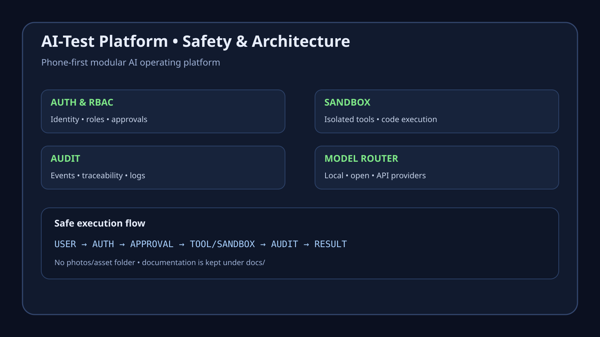

# Safety Architecture

The AI-Test platform treats safety as a first-class subsystem rather than a UI-only feature.

## Control path

```text
User
  ↓
Authentication / RBAC
  ↓
Policy + approval gate
  ↓
Tool or sandbox execution
  ↓
Audit event
  ↓
Result / artifact
```

## Safety boundaries

- **Authentication:** identify the caller before privileged operations.
- **Authorization:** restrict tools and resources by role and policy.
- **Approval:** require human confirmation for destructive, privileged, or high-impact actions.
- **Sandbox:** isolate code execution and untrusted workloads.
- **Audit:** retain structured records of security-sensitive actions.
- **Secrets:** use deployment secret stores/environment configuration rather than source files.
- **Network:** restrict outbound access for sandboxed workloads where practical.
- **Artifacts:** validate generated files before they are promoted into trusted project areas.

## Visual reference



The visual reference is intentionally documentation-safe and contains no credentials or user data.
