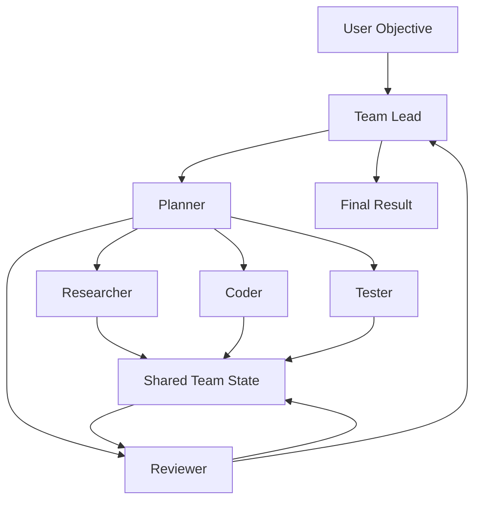

# AI Agent Teams

The platform supports teams of specialized AI agents rather than forcing one agent to perform every task.



## Strategies

- `sequential`: members execute a dependency chain.
- `parallel`: independent tasks run concurrently up to `maxConcurrency`.
- `hierarchical`: a lead delegates work to specialists.
- `debate`: multiple agents produce competing analyses followed by review.
- `consensus`: agents independently evaluate a task and a reviewer consolidates the results.

## Example team

```text
Software Engineering Team
├── Lead Agent
├── Planner Agent
├── Research Agent
├── Coder Agent
├── Tester Agent
└── Reviewer Agent
```

## Shared state

Team state should contain task status, intermediate artifacts, citations, tool outputs, sandbox execution IDs, and review decisions. Agents should not silently overwrite another agent's work; writes should be attributable to a member and run.

## Safety

Teams do not bypass security. Every member remains subject to the same authentication, authorization, tool permissions, model policies, and sandbox restrictions as an individual agent.
