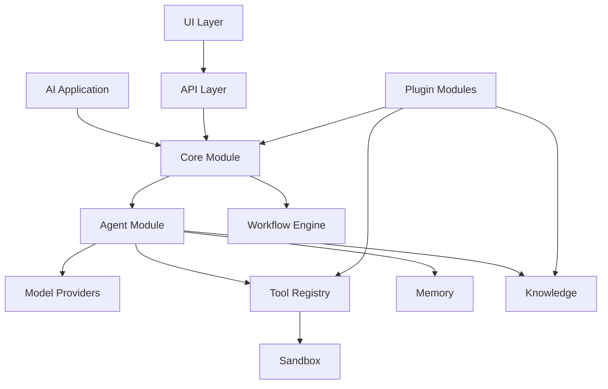

# Modular Architecture

The AI Test clone is organized as independently deployable and replaceable modules with explicit contracts.



## Module contract

Every module has an ID, semantic version, kind, entrypoint, dependency list, capabilities, and configuration schema. `ModuleRegistry` controls registration and enabled/disabled state.

## Design rules

1. Modules communicate through typed interfaces rather than importing implementation details across boundaries.
2. Provider implementations remain replaceable. A local model, remote model, or future provider can implement the same model contract.
3. Tools execute through the tool registry and use the sandbox for untrusted code.
4. Configuration is externalized into environment/config files.
5. Persistence is isolated behind data-access services; modules do not embed database credentials.
6. Optional capabilities are represented as optional module dependencies.
7. Security-sensitive modules such as sandbox and authentication have explicit policies.

## Planned module tree

```text
src/
├── core/
├── agents/
├── models/
├── tools/
├── memory/
├── workflows/
├── sandbox/
├── knowledge/
├── modules/
├── api/
├── security/
├── plugins/
└── ui/
```

This structure allows individual modules to be tested, upgraded, disabled, or replaced without redesigning the entire application.
