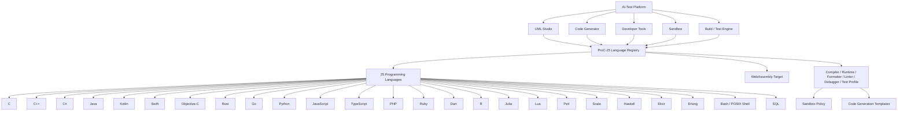

# ProC-25 Programming Languages UML

The AI-Test platform treats programming languages as a first-class capability of the code-generation, UML Studio, tool, sandbox, and build subsystems.



## Language menu

```text
Programming Languages
├── ProC-25
│   ├── C
│   ├── C++
│   ├── C#
│   ├── Java
│   ├── Kotlin
│   ├── Swift
│   ├── Objective-C
│   ├── Rust
│   ├── Go
│   ├── Python
│   ├── JavaScript
│   ├── TypeScript
│   ├── PHP
│   ├── Ruby
│   ├── Dart
│   ├── R
│   ├── Julia
│   ├── Lua
│   ├── Perl
│   ├── Scala
│   ├── Haskell
│   ├── Elixir
│   ├── Erlang
│   ├── Bash / POSIX Shell
│   └── SQL
├── Toolchains
├── Package Managers
├── Formatters
├── Linters
├── Debuggers
├── Test Runners
├── Build Systems
└── WebAssembly Targets
```

## UML Studio behavior

Each language is represented as a selectable UML/code-generation profile. A language node can be connected to:

- an agent;
- a model/tool call;
- a code-generation template;
- a compiler or interpreter;
- a formatter and linter;
- a debugger;
- a test runner;
- a build system;
- a sandbox policy;
- a target runtime;
- a WebAssembly target where supported.

The runtime registry is implemented in `src/languages/proc25.ts` and exported through `src/languages/index.ts`.
