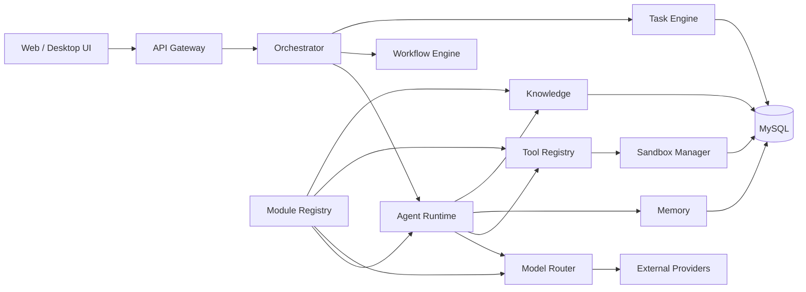

# System Architecture



## Runtime flow

```text
request
  -> authentication/authorization
  -> orchestrator
  -> task/workflow planning
  -> agent selection
  -> model/tool calls
  -> sandbox when execution is required
  -> memory/knowledge persistence
  -> response
```

## Deployment architectures

### Local development

```text
Browser -> API -> Node/TypeScript runtime -> MySQL
                           |-> Ollama
                           |-> Sandbox driver
```

### Production

```text
Load Balancer
    |
API instances
    |
Orchestrator / Worker / Scheduler
    |          |             |
Model GW   Tool GW       Job Queue
    |          |
Providers   Sandboxed runtimes
    |
MySQL / cache / object storage
```

The same domain contracts are used in both architectures. Deployment-specific drivers are selected through configuration.
