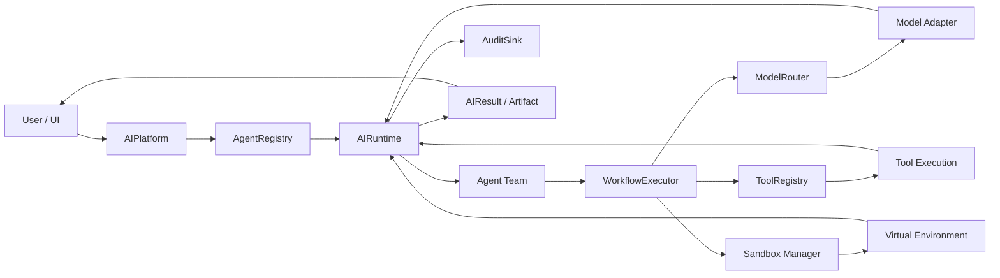

# AI-Test Execution Pipeline UML

## Runtime contract

1. `AIPlatform.execute()` resolves the requested agent and builds the `AIContext`.
2. `AIRuntime.execute()` provides the common request/error/audit boundary.
3. `WorkflowExecutor` resolves dependency order and dispatches agent/tool nodes.
4. `ModelRouter` selects a registered model adapter and supports provider fallback.
5. Sandbox execution is represented by the sandbox contracts and is intended to remain isolated from the UI.
6. `AuditSink` records request, workflow, tool/model, sandbox, result, and error events.
7. GitHub Pages uses a browser-only demo adapter; it does not execute server-side sandbox code.

## Security boundary

The production runtime must enforce authentication, authorization, resource limits, network policy, filesystem isolation, process isolation, timeouts, and audit logging before executing untrusted code. The current repository contracts provide the integration points; they are not a substitute for OS/container/VM isolation.
