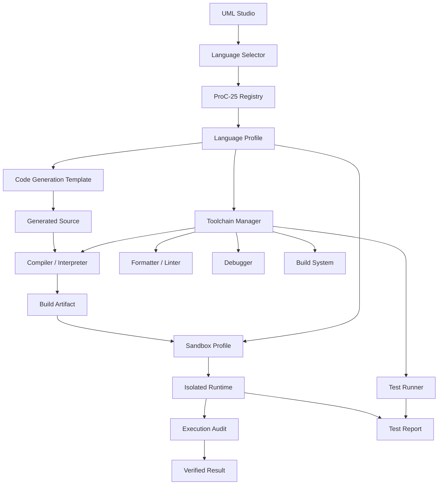

# UML — Programming Language Toolchain Runtime

This document defines how a selected ProC-25 language flows from UML Studio into project configuration, code generation, toolchain selection, sandbox execution, testing, and audit.

## Runtime contract

Selecting a language changes the development profile; it does not grant unrestricted host execution. The language profile supplies the toolchain metadata and a default restricted sandbox configuration. Actual execution remains subject to the platform security and approval policies.

## Implementation

- `src/languages/proc25.ts` — canonical language registry.
- `src/languages/toolchain.ts` — language project/toolchain/sandbox profile manager.
- `src/languages/navigation.ts` — Programming Languages → ProC-25 menu hierarchy.
- `src/languages/index.ts` — public language subsystem exports.

## UML Studio behavior

A language node should expose these panels:

1. Language Profile
2. Source Extensions
3. Compiler / Interpreter
4. Package Manager
5. Formatter
6. Linter
7. Debugger
8. Test Runner
9. Build System
10. Code Generation
11. Sandbox Profile
12. WebAssembly Target, when supported

## Security boundary

The compiler, interpreter, package manager, generated program, and test runner are treated as execution-capable components. They must execute through the sandbox and audit path rather than directly receiving unrestricted host access.
