# UML Architecture Tree

This document defines the UML-style node tree for the modular AI platform. It is the canonical map from folders to architectural components.

```mermaid
flowchart TD
    ROOT[AI Platform]

    ROOT --> APP[Applications]
    ROOT --> CORE[Core Architecture]
    ROOT --> AGENTS[Agent Architecture]
    ROOT --> MODELS[Model Architecture]
    ROOT --> LANG[Programming Languages]
    ROOT --> TOOLS[Tool Architecture]
    ROOT --> KNOW[Knowledge Architecture]
    ROOT --> MEMORY[Memory Architecture]
    ROOT --> WORK[Workflow Architecture]
    ROOT --> TASK[Task Architecture]
    ROOT --> SANDBOX[Sandbox Architecture]
    ROOT --> SECURITY[Security Architecture]
    ROOT --> API[API Architecture]
    ROOT --> DATA[Data Architecture]
    ROOT --> INFRA[Infrastructure]
    ROOT --> DOCS[Documentation]

    APP --> WEB[Web App]
    APP --> DESKTOP[Desktop App]

    CORE --> CTX[AIContext]
    CORE --> MSG[AIMessage]
    CORE --> RESULT[AIResult]
    CORE --> EVENTS[Event Bus]
    CORE --> CONFIG[Configuration]

    AGENTS --> ORCH[Orchestrator]
    AGENTS --> PLAN[Planner]
    AGENTS --> CODE[Coder]
    AGENTS --> RESEARCH[Researcher]
    AGENTS --> GH[GitHub Agent]
    AGENTS --> TOOLAGENT[Tool Agent]

    MODELS --> ROUTER[Model Router]
    MODELS --> OLLAMA[Ollama Provider]
    MODELS --> LLAMA[Llama.cpp Provider]
    MODELS --> COMPAT[OpenAI-Compatible Provider]
    MODELS --> CUSTOM[Custom Provider]

    LANG --> PROC25[ProC-25 Registry]
    PROC25 --> NATIVE[Native / Systems]
    PROC25 --> JVM[JVM Languages]
    PROC25 --> WEBLANG[Web Languages]
    PROC25 --> SCRIPT[Script Languages]
    PROC25 --> SCI[Scientific Languages]
    PROC25 --> DATA_LANG[SQL]
    PROC25 --> TOOLCHAIN[Compiler / Runtime / Package / Debug / Test]
    PROC25 --> WASM[WebAssembly Targets]

    TOOLS --> REG[Tool Registry]
    TOOLS --> MATH[Math Engine]
    TOOLS --> DICT[Dictionary Tool]
    TOOLS --> SEARCH[Search Tool]
    TOOLS --> FILES[File Tool]
    TOOLS --> EXEC[Execution Tool]
    TOOLS --> CODEGEN[Code Generator]

    KNOW --> DICTIONARY[Multilingual Dictionary]
    KNOW --> MATHKB[Math Knowledge]
    KNOW --> DOCSDB[Document Knowledge]
    KNOW --> RETRIEVAL[Retrieval]

    MEMORY --> SHORT[Short-Term Memory]
    MEMORY --> LONG[Long-Term Memory]
    MEMORY --> VECTOR[Vector / Embedding Store]

    WORK --> GRAPH[Workflow Graph]
    WORK --> ENGINE[Workflow Runtime]
    WORK --> LOOP[Loop / Parallel Runtime]
    WORK --> CONDITIONS[Condition Runtime]

    TASK --> TREE[Task Tree]
    TASK --> QUEUE[Task Queue]
    TASK --> SCHED[Scheduler]

    SANDBOX --> SBENV[Sandbox Environment]
    SANDBOX --> VENV[Virtual Environment]
    SANDBOX --> DRIVER[Isolation Driver]
    SANDBOX --> POLICY[Sandbox Policy]
    SANDBOX --> AUDIT[Execution Audit]
    SANDBOX --> LANGPROFILE[Language Toolchain Profile]

    SECURITY --> AUTH[Authentication]
    SECURITY --> RBAC[Authorization / RBAC]
    SECURITY --> SECRETS[Secret Management]
    SECURITY --> RATE[Rate Limiting]
    SECURITY --> THREAT[Threat Model]

    API --> HTTP[HTTP API]
    API --> WS[WebSocket / SSE]
    API --> CONTRACTS[API Contracts]

    DATA --> MYSQL[(MySQL)]
    DATA --> CACHE[(Cache)]
    DATA --> OBJECT[(Object Storage)]

    INFRA --> DOCKER[Containers]
    INFRA --> CI[GitHub Actions]
    INFRA --> OBS[Observability]

    DOCS --> UML[UML]
    DOCS --> ADR[Architecture Decisions]
    DOCS --> RUNBOOK[Runbooks]
    DOCS --> LANGDOC[Programming Language Matrix]
```



## Language node semantics

The ProC-25 node is a capability registry, not a requirement that every compiler be installed on every machine. Each language profile declares its source extensions, toolchain, formatter, linter, debugger, test runner, build system, runtime, and sandbox requirements.

## Folder-to-node mapping

```text
src/core       -> Core
src/agents     -> Agents
src/models     -> Models
src/languages  -> Programming Languages / ProC-25
src/tools      -> Tools
src/knowledge  -> Knowledge
src/memory     -> Memory
src/workflows  -> Workflow
src/tasks      -> Task
src/sandbox    -> Sandbox
src/security   -> Security
src/api        -> API
src/modules    -> Module Registry
services/*     -> Runtime deployment nodes
database/*     -> Data nodes
configs/*      -> Configuration nodes
docs/*         -> Documentation nodes
tests/*        -> Verification nodes
```

## Design rule

A UML node may contain multiple implementation files and subfolders, but a source file should have one primary architectural owner. Cross-cutting behavior is exposed through interfaces rather than direct imports across unrelated nodes.
